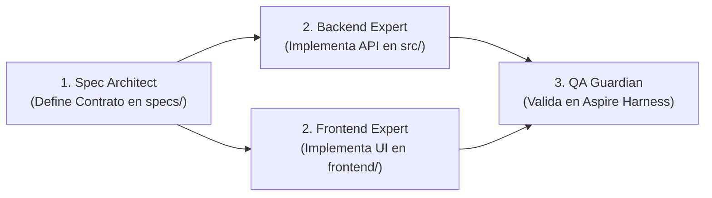

# 🤖 Protocolo Maestro de Desarrollo Multi-Agente (AGENTS.md)

Este documento rige la colaboración autónoma entre agentes de Inteligencia Artificial que operan sobre el monorepo **`proyecto-fullstack-harness`**.

---

## 1. Topología del Monorepo

| Directorio | Responsable Exclusivo | Descripción |
| :--- | :--- | :--- |
| `specs/` | `spec-architect` | Contratos OpenAPI, especificaciones de requerimientos y ADRs. |
| `src/` | `dotnet-backend-expert` | Backend en .NET 10, FastEndpoints, EF Core y Redis. |
| `frontend/` | `frontend-expert` | Frontend en React + Vite + TypeScript. |
| `harness/` | `harness-maintainer` / Compartido | Orquestador .NET Aspire AppHost. |
| `tests/` | `qa-guardian` | Pruebas de integración, arquitectura y carga. |

---

## 2. Flujo de Trabajo en Modo /teamwork

1. **Paso 1: Especificar Primero (*Contract-First*)**:
   - Ningún agente de código comienza a implementar sin un archivo en `specs/` que defina el contrato JSON exacto.
2. **Paso 2: Implementación Paralela**:
   - `dotnet-backend-expert` implementa el endpoint en `src/Backend.Api/Endpoints/` y la persistencia en `src/Backend.Infrastructure/`.
   - `frontend-expert` implementa el componente en `frontend/src/` consumiendo el endpoint acordado.
3. **Paso 3: Verificación Integrada en el Harness**:
   - `qa-guardian` ejecuta `dotnet build`, `npm run build` y corre las pruebas automáticas.
   - Si todo está en verde, se aprueba el cambio.

---

## 3. Reglas Estrictas e Invariantes

1. **Prohibición de Colisión de Archivos**:
   - El agente del Backend **NUNCA** edita archivos dentro de `frontend/`.
   - El agente del Frontend **NUNCA** edita archivos dentro de `src/` o `harness/`.
2. **Sin Cadenas Hardcodeadas**:
   - Las conexiones a SQL Server y Redis son inyectadas automáticamente por el **AppHost de Aspire**. Nunca quemar IPs ni credenciales en código.
3. **Validación de Compilación Obligatoria**:
   - Antes de reportar una tarea como completada, el agente debe verificar que `dotnet build` devuelva 0 errores y que `npm run build` en `frontend/` compile con éxito.
