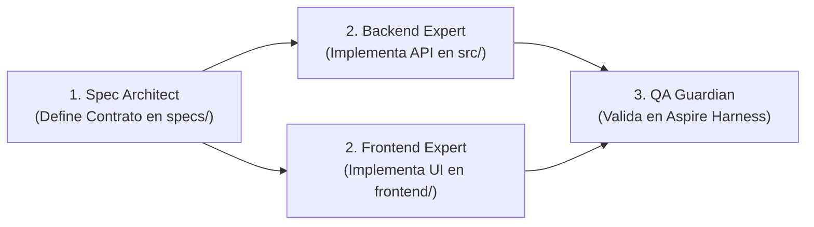

# 🤖 Protocolo Maestro de Desarrollo Multi-Agente (AGENTS.md)

Este documento rige la colaboración autónoma entre agentes de Inteligencia Artificial que operan sobre el monorepo **`proyecto-fullstack-harness`**.

---

## 1. Topología del Monorepo

| Directorio | Responsable Exclusivo | Descripción |
| :--- | :--- | :--- |
| `specs/` | `spec-architect` | Contratos OpenAPI, especificaciones de requerimientos y ADRs. |
| `src/` | `dotnet-backend-expert` | Backend en .NET 10, FastEndpoints, EF Core y Redis. |
| `frontend/` | `frontend-expert` | Frontend en React + Vite + TypeScript. |
| `harness/` | `harness-maintainer` / Compartido | Orquestador .NET Aspire AppHost. |
| `tests/` | `qa-guardian` | Pruebas de integración, arquitectura y carga. |
| *Transversal* | `debug-expert` | Diagnóstico sistemático, aislamiento de causa raíz y resolución quirúrgica de anomalías. |

---

## 2. Flujo de Trabajo en Modo /teamwork

1. **Paso 1: Especificar Primero (*Contract-First*)**:
   - Ningún agente de código comienza a implementar sin un archivo en `specs/` que defina el contrato JSON exacto.
2. **Paso 2: Implementación Paralela**:
   - `dotnet-backend-expert` implementa el endpoint en `src/Backend.Api/Endpoints/` y la persistencia en `src/Backend.Api/Infrastructure/`.
   - `frontend-expert` implementa el componente en `frontend/src/` consumiendo el endpoint acordado.
3. **Paso 3: Verificación Integrada en el Harness**:
   - `qa-guardian` ejecuta `dotnet build`, `npm run build` y corre las pruebas automáticas.
   - Si todo está en verde, se aprueba el cambio.

---

## 3. Reglas Estrictas e Invariantes

1. **Prohibición de Colisión de Archivos**:
   - El agente del Backend **NUNCA** edita archivos dentro de `frontend/`.
   - El agente del Frontend **NUNCA** edita archivos dentro de `src/` o `harness/`.
2. **Sin Cadenas Hardcodeadas**:
   - Las conexiones a SQL Server y Redis son inyectadas automáticamente por el **AppHost de Aspire**. Nunca quemar IPs ni credenciales en código.
3. **Validación de Compilación Obligatoria**:
   - Antes de reportar una tarea como completada, el agente debe verificar que `dotnet build` devuelva 0 errores y que `npm run build` en `frontend/` compile con éxito.

---

## 4. Estándar de Ingeniería para `frontend-expert`

El agente `frontend-expert` opera bajo los estándares de ingeniería senior y herramientas probadas en `react-template-vite`:
1. **Atomic Design**: Componentes organizados en `atoms/`, `molecules/`, `organisms/`, `layouts/` y `pages/`.
2. **Inversión de Control (IoC)**: Todo servicio o llamada de API se registra en `src/app/app.ioc.ts` y se inyecta con `useInjection()`, habilitando mocking instantáneo en tests.
3. **Validación Zod**: Contratos de datos, parsing de respuestas HTTP y validaciones de formularios tipadas vía `zod` (`*.schema.ts`).
4. **Testing TDD**: Pruebas con **Vitest** y **React Testing Library** (`npm run test:run`).
5. **Scaffolds y Prompts**: Uso de plantillas en `.vscode/__templates__/` y prompts en `.agent/prompts/`.

---

## 5. Protocolo de Depuración con `debug-expert`

Cuando las pruebas automatizadas o la compilación fallen, entra en acción el agente `debug-expert` bajo un protocolo de 4 fases:
1. **Evaluación y Reproducción**: Analiza logs, stack traces y redacta un test automatizado que falle (Red).
2. **Investigación de Causa Raíz**: Traza el flujo de datos, inyecciones de IoC, esquemas Zod o proxy de Aspire.
3. **Resolución Quirúrgica**: Aplica el arreglo mínimo sin introducir refactorizaciones fuera de alcance.
4. **Verificación y Prevención**: Confirma que el test pase a verde (Green) y valida la suite completa sin regresiones.

---

## 6. Estándar de Ingeniería para `dotnet-backend-expert`

El agente `dotnet-backend-expert` opera bajo los estándares de ingeniería senior inspirados en `ACHS.Concurrencias.API.Net8`:
1. **Patrón Vertical Slice REPR**: Cada endpoint es una clase aislada `Endpoint<TRequest, TResponse>` en `src/Backend.Api/Endpoints/` con DTOs explícitos y validadores FluentValidation.
2. **Endpoints Delgados**: Delegación de la lógica de negocio a servicios o entidades de dominio. `HandleAsync` orquesta y formatea la respuesta.
3. **Decisión Consciente de Autorización**: Cada endpoint define explícitamente `AllowAnonymous()` o sus políticas de seguridad en `Configure()`.
4. **Propagación Asíncrona Rigurosa**: Propagar siempre `CancellationToken ct` provisto por FastEndpoints a todas las operaciones de EF Core y Redis.
5. **Manejo de Errores RFC 7807**: Uso de ProblemDetails centralizado, prohibiendo la filtración de detalles internos de excepciones (`ex.Message` o stack traces) hacia los clientes HTTP.
6. **Testing TDD con xUnit**: Pruebas unitarias y de validadores en `tests/Backend.Api.Tests` ejecutables con `dotnet test`.

